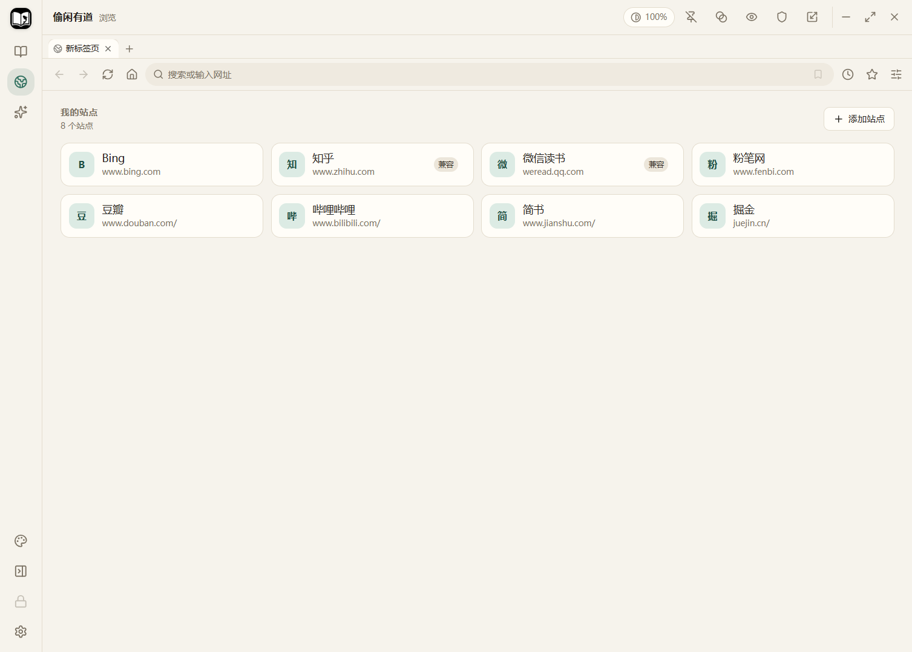
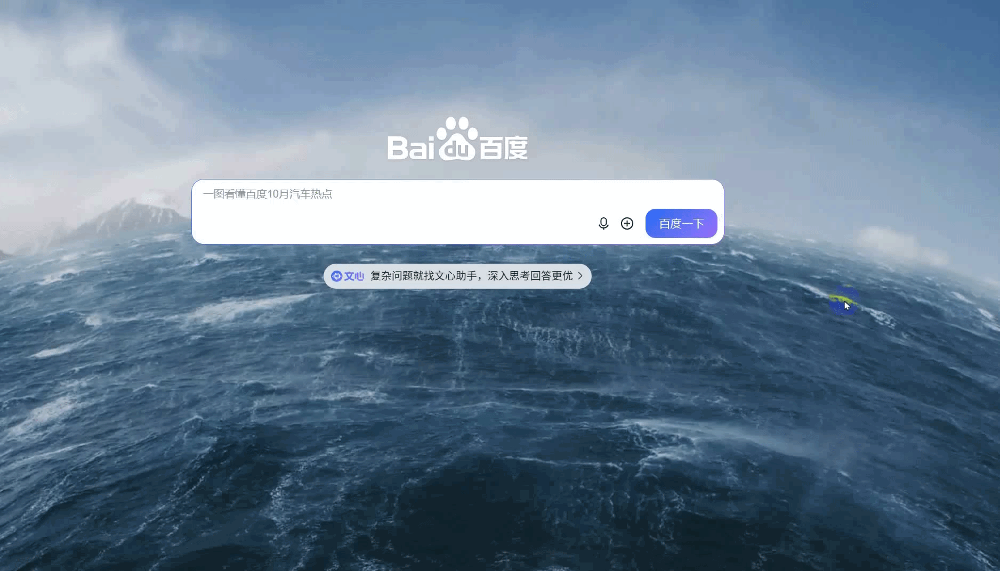
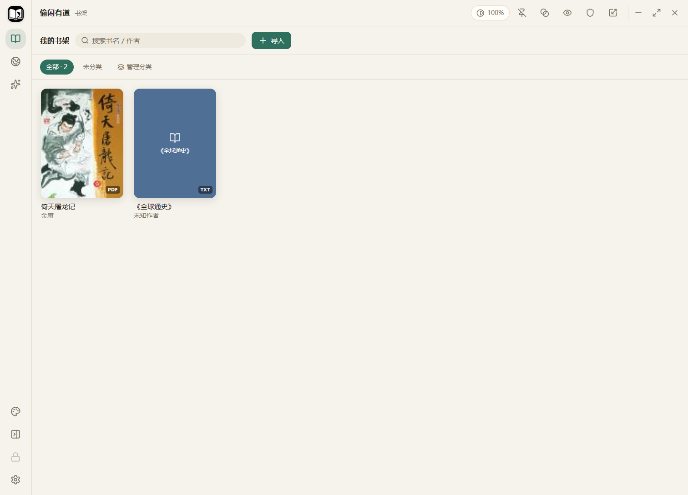
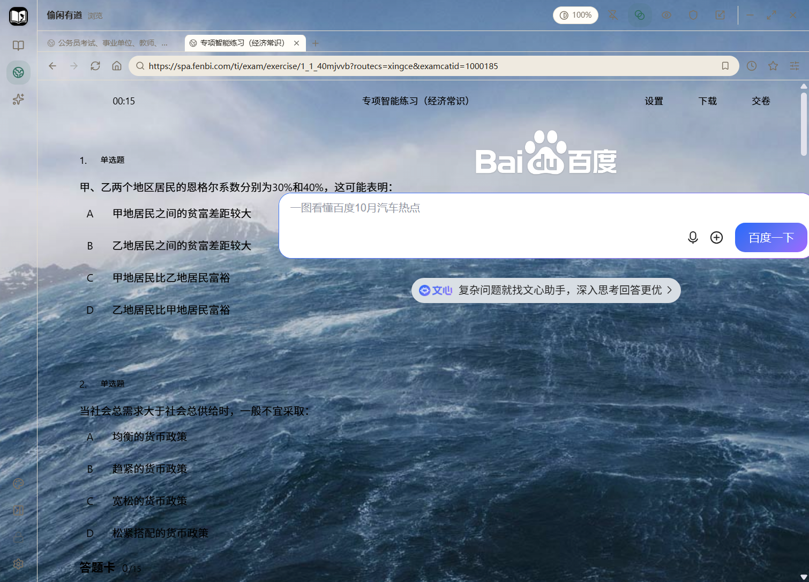
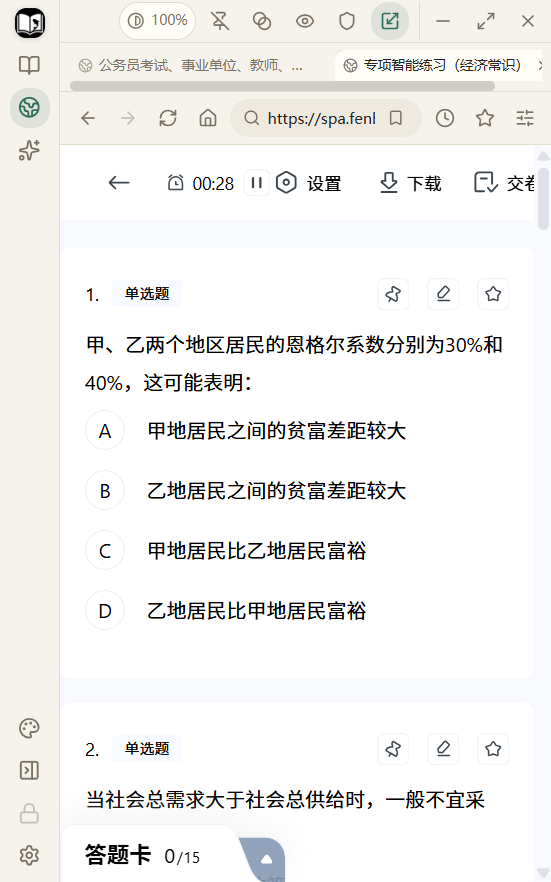
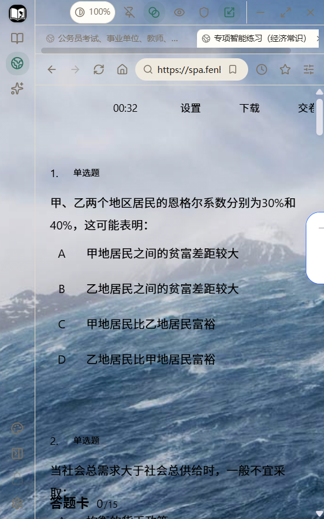
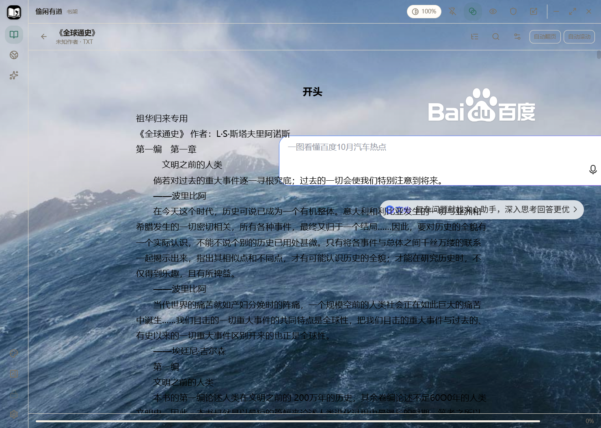

# 偷闲有道（Idlewise）

一款 Windows 上班摸鱼用的「隐蔽阅读器」。把网页、题库、小说和 AI 工具塞进一个透明、置顶、无边框的悬浮窗里：窗口能变透明让内容浮在桌面上，鼠标移开自动隐藏，老板键一键退到后台。

<p align="center">
  
  
  
  
  
</p>

<p align="center">
  
</p>

<p align="center">
  
</p>

<p align="center"><sub>鼠标移开自动隐藏 / 网页透明演示</sub></p>

## 🫥 隐蔽能力

上班摸鱼最怕被抓包，Idlewise 围绕“不被发现”做了几件事：

- **网页透明**：抠掉网页背景、卡片和图片，只留文字浮在桌面上
- **鼠标移开即隐藏**：菜单栏和主体可独立自动隐藏，移回窗口或顶部热区恢复
- **老板键**：`Alt+Z` 最小化/恢复，`Alt+X` 退到后台，可自定义
- **防截图录屏**：系统级 `WDA_EXCLUDEFROMCAPTURE`，截图工具拍不到窗口
- **窗口透明度**：0–100% 无极调节，文字和背景透明度可分开控制
- **迷你模式**：缩成 440×360，工具按钮自动紧凑但不重叠

## 🐟 能摸什么鱼

- **刷题备考**：粉笔、题库网页，网页透明后只剩题干
- **看小说**：本地 EPUB / MOBI / AZW3 / PDF / TXT，五种格式
- **任意网页**：微信读书、豆瓣、B 站、知乎、简书、掘金……
- **AI 工具**：豆包、DeepSeek、Kimi、元宝、智谱、ChatGPT 一键直达
- **多标签**：中键关标签、中键链接开新标签，历史/收藏以标签页打开

## 🖼️ 截图

> 以下为实机截图，按内容比例缩放；GIF 演示鼠标移开自动隐藏与网页透明。

<table>
  <tr>
    <td width="50%" align="center"><br /><sub>书架</sub></td>
    <td width="50%" align="center"><br /><sub>网页透明</sub></td>
  </tr>
  <tr>
    <td align="center"><br /><sub>Mini 模式</sub></td>
    <td align="center"><br /><sub>Mini 模式 + 网页透明</sub></td>
  </tr>
</table>

<p align="center">
  
</p>
<p align="center"><sub>TXT 阅读（透明模式）</sub></p>

## 📥 下载

到 [Releases](../../releases) 下载最新版。

未配置代码签名证书，首次运行可能触发 SmartScreen 提示。

## ⌨️ 快捷键

| 按键 | 作用 |
|---|---|
| `Alt+Z` | 最小化 / 恢复（可自定义） |
| `Alt+X` | 隐藏到后台 / 托盘（可自定义） |
| `Esc` | 关闭弹层 / 阅读面板 |
| 鼠标中键点标签 | 关闭标签 |
| 鼠标中键点链接 | 新标签打开 |

## 🛠️ 从源码构建

需要 Node.js ≥ 20。

```bash
npm install
npm run dev        # 开发模式
npm run build      # 构建主进程与渲染层
npm test           # 单元测试
npm run build:win  # NSIS 安装版 + 便携版
```

构建产物：

- `dist/idlewise-1.0.0-setup.exe`
- `dist/idlewise-1.0.0-portable.exe`

## 🧪 测试

```bash
npm run typecheck
npm run lint
npm test
npm run test:e2e
node scripts/window-browser-test.cjs
node scripts/browser-features-test.cjs
node scripts/reader-test.cjs
node scripts/ai-tools-test.cjs
node scripts/font-color-test.cjs
node scripts/transparent-sites-test.cjs
```

完整测试范围与回归脚本见 `scripts/` 目录。

## 🚀 CI/CD

`.github/workflows/release.yml`：

- 推送到 `main` / `master`、PR、手动触发：typecheck、lint、单测、构建 Windows 包，并上传 artifact
- 推送 `v*` 标签：校验版本后创建 GitHub Release，附加 setup、portable 与 blockmap

```bash
git tag v1.0.0
git push origin v1.0.0
```

## 📁 数据与隐私

所有数据保存在 `%APPDATA%\Idlewise`：

- `settings.json` / `library.json` / `history.json` / `bookmarks.json` / `sites.json`
- `lock.bin`（系统安全存储加密）
- `assets/`（自定义背景、托盘图标）

不启用账号体系，不上传阅读内容、浏览记录或密码。

## 📄 声明

本项目为独立实现，与任何第三方产品无关联。使用 foliate-js、pdf.js、Electron、React 等开源组件，版权归各自作者。

本产品仅供学习交流，禁止用于非法用途。使用者需自行遵守当地法律法规及所在单位规章制度。

## 许可证

Apache License 2.0，见 [LICENSE](LICENSE) 与 [NOTICE](NOTICE)。
